# Industrial Electropneumatic & Electrohydraulic Automation — Siemens S7-1200 PLC & KTP700 HMI

[-009999?style=flat-square)](#1-siemens-s7-1200-plc-ladder-programming)
[-006487?style=flat-square)](#2-wincc-simatic-ktp700-hmi-interface)

> End-to-end industrial automation portfolio covering **FluidSIM circuit simulation**, **electropneumatic & electrohydraulic control**, **Siemens S7-1200 PLC Ladder (`LAD`) programming** (`SET/RESET` step sequencers, `TON` IEC timers, `CTU` counters, 8-group cascades, and `0–10 V` analog scaling via `NORM_X`/`SCALE_X`), **2-screen WinCC SIMATIC KTP700 HMI supervision**, and **physical commissioning on Festo training benches**.

  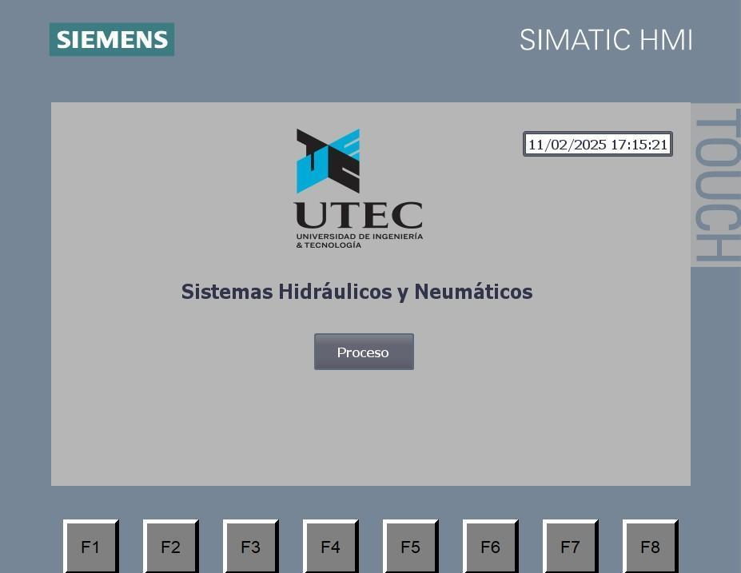
  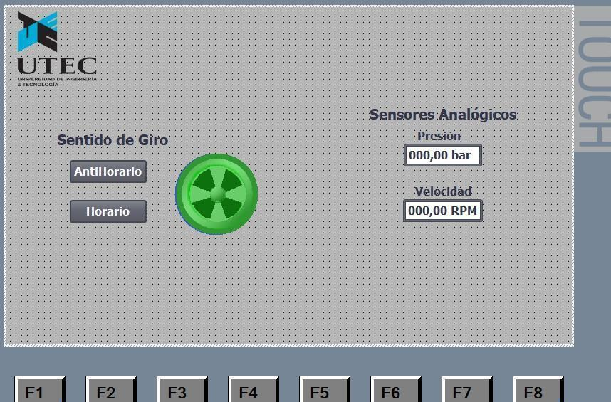

---

## Core Industrial Automation Competencies

- **PLC Programming (`Siemens S7-1200` / `TIA Portal V15`):** Structured `LAD` programming covering single/continuous cycles, `SET`/`RESET` state-machine step sequencers, `IEC_Timer` (`TON`) delays, `CTU` cycle counters, and multi-group cascade architectures.
- **Analog Signal Conditioning (`0–10 V`):** Raw 16-bit peripheral normalization (`0 – 27648` via `NORM_X`) and linear engineering scaling (`SCALE_X`) for real-time hydraulic pressure (**bar**) and motor rotational speed (**RPM**).
- **HMI / SCADA Design (`WinCC` / `KTP700 Basic`, PROFINET):** 2-screen operator interface with global function-key templates (`F1` Home, `F8` Stop Runtime), live decimal telemetry, and bidirectional hydraulic motor control (`CW` / `CCW`).
- **Fluid Power Engineering (`FluidSIM` & `Festo`):** Pneumatic intuitive/cascade/step-sequencer design, electrohydraulic directional control (3-position solenoid valves), hydraulic accumulators, and industrial 3-wire proximity & piezoresistive pressure sensors.

---

## 1. Siemens S7-1200 PLC Ladder Programming

### 1.1 `0–10 V` Analog Scaling (`NORM_X` → `SCALE_X`)
Industrial pressure and tachometer sensors deliver `0–10 V` signals mapped to `0–27648` raw counts on the S7-1200 analog input module. Each signal is normalized (`Int → Real`, `0.0–1.0`) via `NORM_X` and scaled via `SCALE_X` into **bar** and **RPM** for live HMI supervision:

  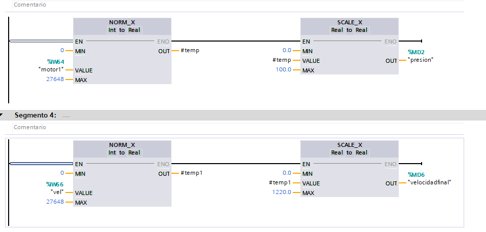

### 1.2 Step-Sequencer State Machine with `SET`/`RESET` & `IEC_Timer` (`TON`)
Implemented electrohydraulic and electropneumatic step transitions using interlocking memory bits (`%M0.5`–`%M1.3`), latched solenoid outputs (`%Q0.0`, `%Q0.1`), and timed dwells (`TON` 2 s / 3 s):

  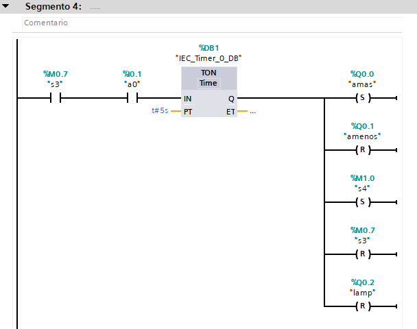
  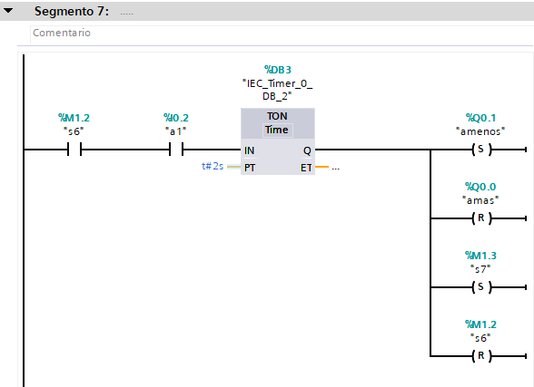

### 1.3 Timed Cascade & Cycle Counting (`(A+ A- 1s B+ 2s B-) × 3`)
Combined cascade memory groups with `TON` delay timers and a `CTU` up-counter (`PV = 3`) for repeatable multi-cycle execution:

  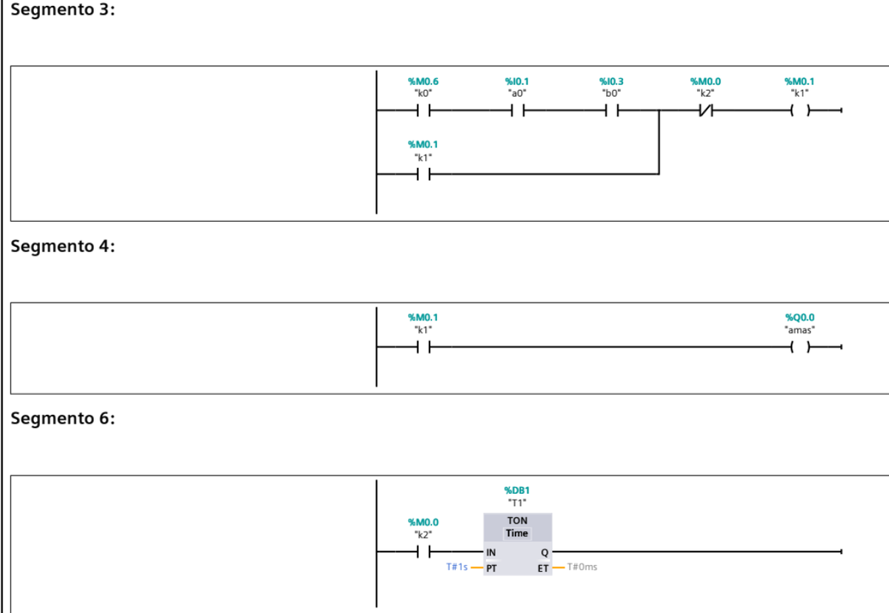
  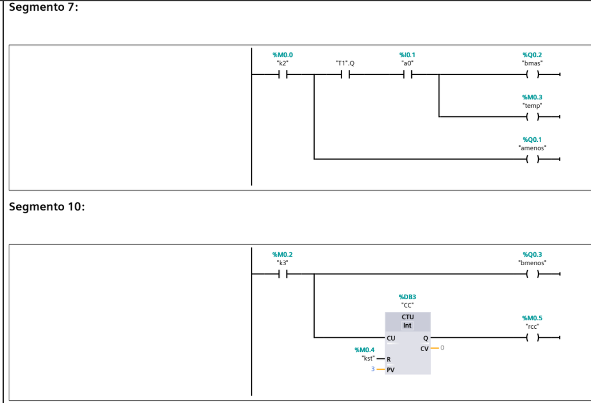

### 1.4 8-Group Complex Cascade (`A+ B+ A- B- D- A+ D+ A-`)
Multi-actuator pneumatic sequence decomposed into 8 mutually exclusive cascade groups (`K1`–`K8`) to eliminate conflicting pilot signals across repeated actuator strokes:

  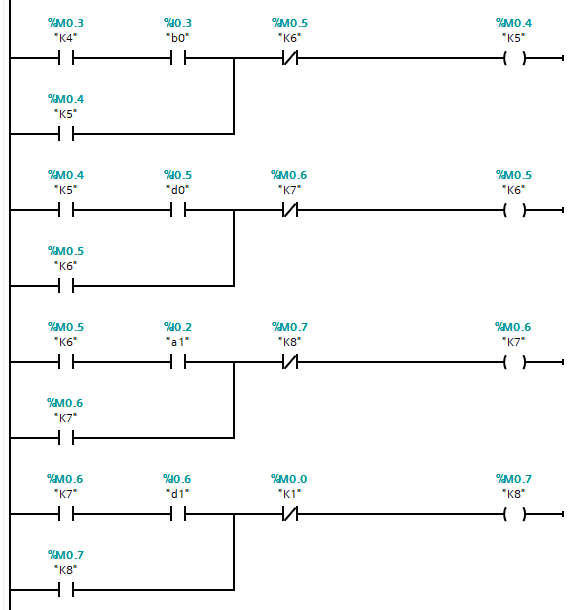
  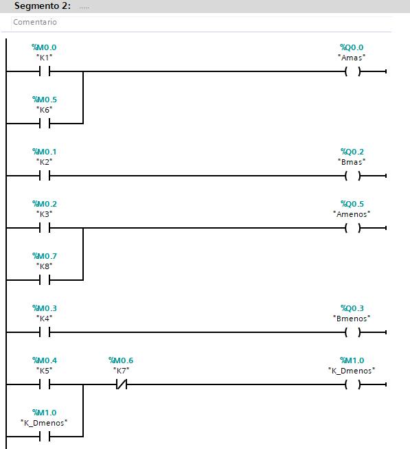

---

## 2. WinCC SIMATIC KTP700 HMI Interface

Designed in **TIA Portal WinCC** for the **SIMATIC KTP700 Basic (`6AV2 123-2GB03-0AX0`)** over **PROFINET**:
- **Screen 1 — Main (`Pantalla Principal`):** System header, live RTC date/time, screen navigation button, and global template mapping (`F1`: Home screen via `ActivateScreen`, `F8`: Stop Runtime via `StopRuntime`).
- **Screen 2 — Process (`Pantalla de Proceso`):** Live numeric indicators (2 decimal precision) for **Hydraulic Pressure (`bar`)** and **Motor Speed (`RPM`)**, plus operator pushbuttons toggling **Clockwise (`Horario`)** and **Counter-Clockwise (`Antihorario`)** hydraulic motor rotation via `InvertBit` PLC memory tags.

---

## 3. FluidSIM Circuit Design & Displacement-Step Analysis

### 3.1 Electrohydraulic Bidirectional Motor & Hydraulic Accumulator
Simulated 3-position solenoid directional control (`V2`) for CW/CCW hydraulic motor actuation, hydraulic accumulator charge/discharge isolation (`V1`), and displacement/speed verification:

  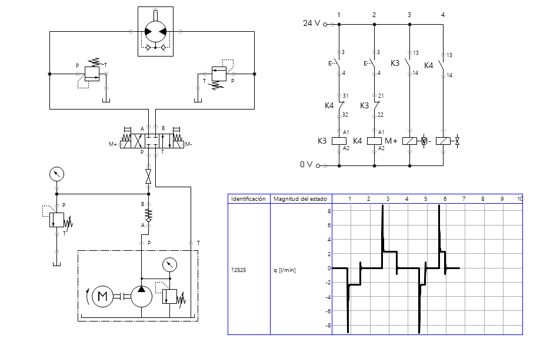
  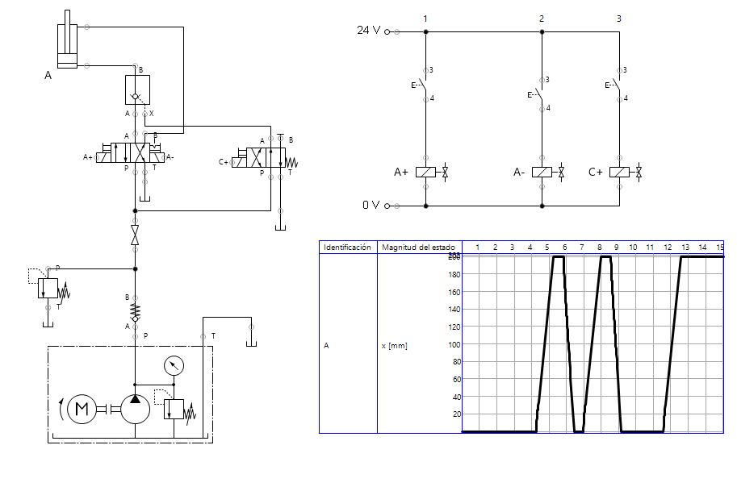

  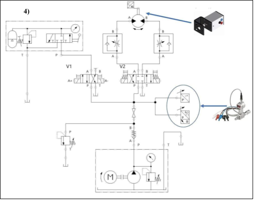

### 3.2 Electropneumatic Relay Cascade & Festo Step Sequencer
Verified power circuits, 24 V relay Ladder schematics, Festo step-sequencer modules, and multi-cycle displacement-step (`Fase-Paso`) diagrams prior to PLC translation:

  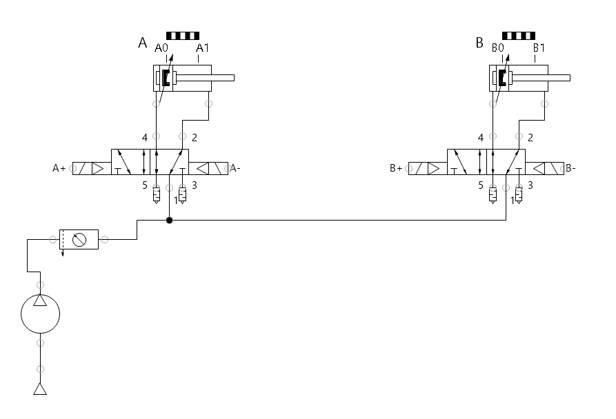
  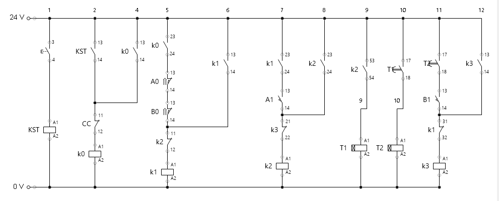

  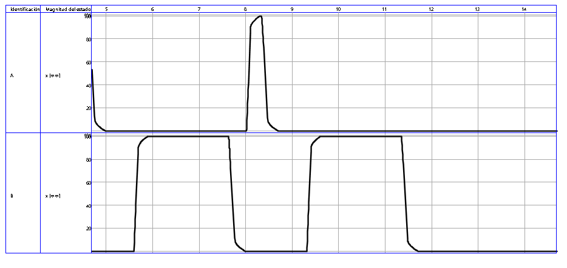
  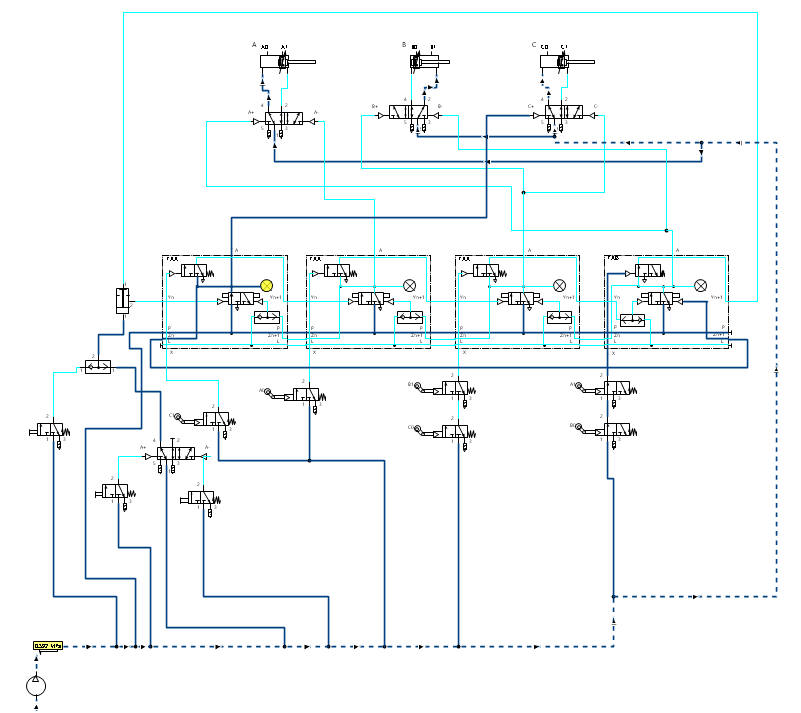

---

## 4. Physical Festo Bench Commissioning

All simulated circuits and TIA Portal PLC/HMI programs were wired and commissioned on physical **Festo** industrial electropneumatic and electrohydraulic benches over **PROFINET / Ethernet**:

  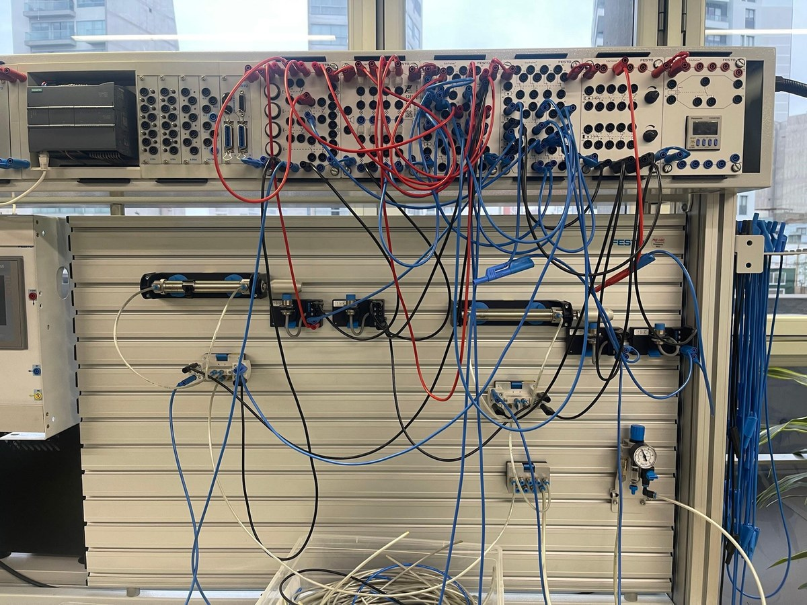
  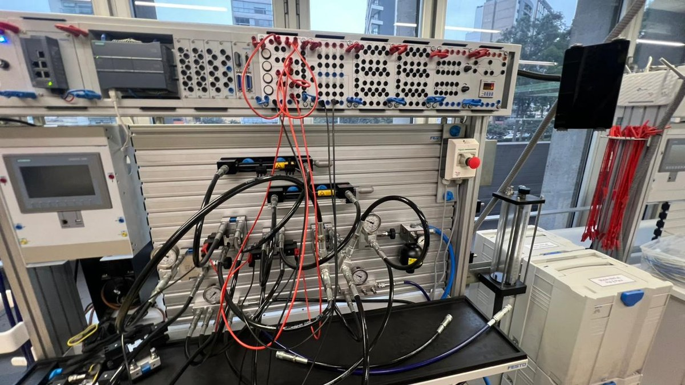
  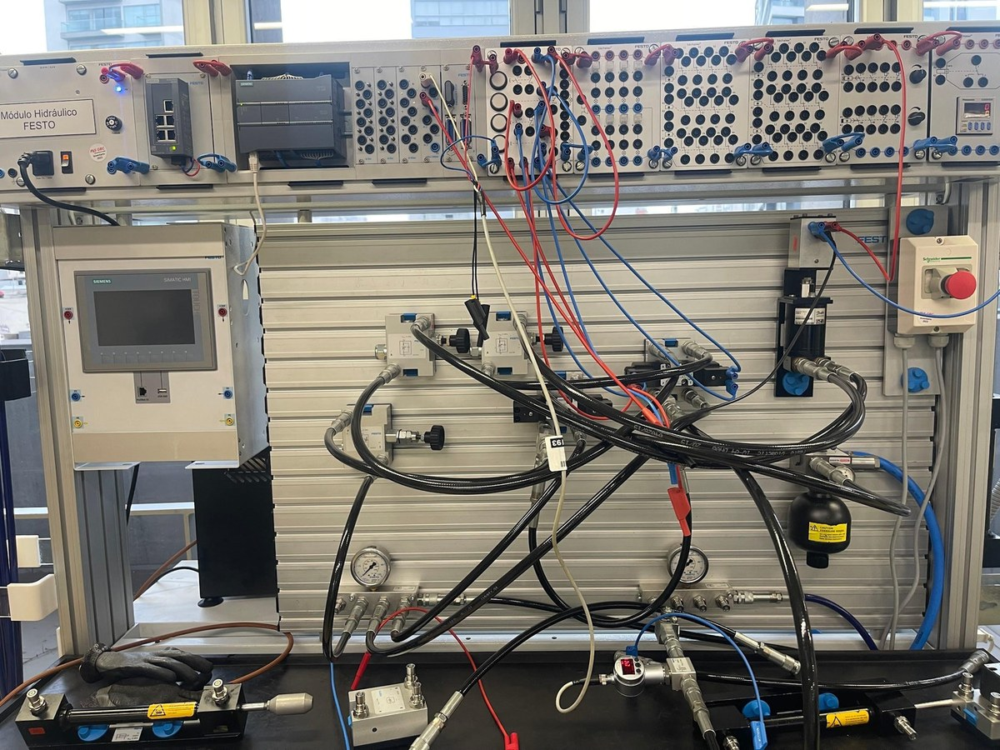

---

## Technical Progression Summary

| Module | Scope | Tools & Industrial Hardware |
| :---: | :--- | :--- |
| **1** | Intuitive & Cascade Pneumatic Design | FluidSIM Pneumatics, Festo benches, timers, counters, reed sensors |
| **2** | Pneumatic Step Sequencer & Electropneumatics | Festo step module, 24 V relays, 3-wire proximity sensors |
| **3** | **Electropneumatic Cascade on Siemens S7-1200** | **TIA Portal V15, S7-1200 Ladder (`TON`, `CTU`, 8-group cascade), Festo solenoid valves** |
| **4** | Hydraulic Circuits & Bidirectional Hydraulic Motor | FluidSIM Hydraulics, 3-position solenoid valves, pressure/flow/RPM characterization |
| **5** | **PLC Analog Scaling (`0–10 V`), Accumulator & KTP700 HMI** | **S7-1200 (`NORM_X`/`SCALE_X`), WinCC KTP700 (PROFINET), Festo hydraulic bench** |

---

## Context & Attribution

- **Course:** Hydraulic and Pneumatic Systems (`MT4002`) — University of Engineering and Technology (UTEC), 2025
- **Contributors (PLC/HMI Implementations):** Sergio Edmundo Beltran Abalos, Arianna Mariajose Castro Carpio

> *Note: Original university lab guide documents are intentionally omitted to respect academic copyright; this repository showcases only personally implemented PLC Ladder logic, WinCC HMI screens, FluidSIM circuits, and physical Festo bench commissioning results.*
